[English](README.md) · [Português](README.pt-BR.md) · **Español**

<a id="top"></a>

<p align="center">
  <a href="#instalar"></a>
</p>

<h1 align="center">editonny</h1>

<p align="center"><strong>Tú pides. El video gana ritmo.</strong></p>

<p align="center">Skill de edición de video gratis y open source para <strong>Claude Code</strong> y <strong>Codex</strong>. Corta pausas y errores, pon subtítulos, trata el audio, reencuadra y convierte partes de tu habla en escenas de motion pidiéndolo en lenguaje natural. La transcripción y el render se ejecutan en tu computadora.</p>

<p align="center">
  <a href="https://github.com/soumatheusgomes/editonny/stargazers"></a>
  <a href="https://github.com/soumatheusgomes/editonny/actions/workflows/verify.yml"></a>
  <a href="LICENSE.md"></a>
  
  
</p>

<p align="center"><a href="#instalar"><strong>Instala con un pedido</strong></a> · <a href="#como-funciona">Cómo funciona</a> · <a href="#laboratorio">Laboratorio</a> · <a href="#motion">Escenas de motion</a> · <a href="#abrir-la-guia">Guía</a> · <a href="#comunidad">Historial de estrellas</a></p>

<p align="center"></p>

<a id="instalar"></a>

## Instala con un pedido

No descargas nada a mano. Abre **Claude Code** o **Codex** en cualquier carpeta y pega este pedido. El mismo pedido instala editonny la primera vez y lo actualiza después: el agente clona la skill desde GitHub, sigue el procedimiento de preparación, verifica todo y pregunta antes de cualquier cosa fuera del pedido.

```text
Instala o actualiza la skill editonny para Codex y Claude Code desde https://github.com/soumatheusgomes/editonny. Clona la versión más reciente en una carpeta temporal; yo no voy a descargar nada manualmente. Lee skills/editonny/SKILL.md y sigue su procedimiento de preparación completa. Si editonny ya está instalado, compara las versiones, resume qué cambia y actualízalo con su método de instalación actual: el instalador del repositorio para la instalación compartida (conserva mi configuración y guarda una copia de seguridad de la versión anterior) o el actualizador del host para un plugin gestionado. Prepara herramientas locales compatibles, el motor con dependencias fijadas, el renderizador y navegador en las versiones fijadas, el modelo predeterminado de transcripción, OCR local para comprobar subtítulos y los recursos incluidos antes de la primera edición. Comprueba todo con diagnósticos y una muestra sintética, informa pendientes, elimina el clon temporal y avísame cuándo reiniciar el agente. Pide autorización antes de servicios de pago o de enviar mis archivos.
```

<p align="center"></p>

Cuando termine, reinicia el agente y llama a **`/editonny` en Claude Code** o **`$editonny` en Codex**. Es el mismo pedido que la guía copia por ti.

| Necesitarás | Versión |
|---|---|
| Claude Code o Codex | Ya configurado |
| Python | 3.9+ para el launcher; el motor usa >=3.10,<3.14 mediante uv |
| uv | Gestor de Python |
| FFmpeg y ffprobe | En el `PATH` |
| Node.js y npx | 22.13+ o 24+ |
| OCR local para comprobar subtítulos | Apple Vision (macOS) o Tesseract |

El agente prepara lo que falte e informa descargas pendientes o comprobaciones fallidas antes de declarar la instalación completa. La transcripción y el render locales no requieren clave de API de LLM; la suscripción de tu agente es aparte. Los generadores externos son opcionales y requieren tu autorización antes de gastos o envío de archivos.

<details>
<summary><strong>¿Prefieres la terminal?</strong></summary>

```sh
git clone https://github.com/soumatheusgomes/editonny.git
cd editonny
python3 install.py --target both
python3 ~/.local/share/editonny/scripts/editonny.py doctor
python3 ~/.local/share/editonny/scripts/editonny.py media status
```

Para un solo agente, usa `--target codex` o `--target claude`. La instalación comparte una copia en `~/.local/share/editonny`, registrada mediante enlaces. Estos comandos registran la skill y preparan el entorno Python. Para la preparación completa (renderizador, navegador, modelo de transcripción, OCR y pruebas sintéticas), pide al agente que lea `skills/editonny/SKILL.md` y siga el [procedimiento de preparación en inglés](skills/editonny/references/setup.md). Cada uso revisa el entorno local y las actualizaciones en GitHub; actualizar requiere tu aceptación.

Instalación aislada, carga como plugin, actualizaciones y desinstalación: [guía de instalación en inglés](docs/installation.md).

</details>

<a id="como-funciona"></a>

## Cómo funciona

<p align="center"></p>

editonny es una skill instalada en tu computadora. Describes el resultado e indicas la carpeta de los videos; la skill examina las grabaciones, selecciona tomas completas, mide cortes con la forma de onda, prepara un proyecto, revisa una muestra y exporta un MP4 verificado.

```text
$editonny
Edit a 45-second vertical video from /path/to/footage.
Keep complete takes, clean pauses, breaths, and mistakes, and add clear captions.
Use visual scenes only where they explain the story.
Verify an 8–15 second sample before finishing the export.
```

1. Elige una intención en la guía, indica la carpeta y copia el pedido (en el idioma de la guía) al agente.
2. La skill inspecciona los archivos seleccionados, propone todos los ajustes de edición y **espera tu confirmación**, incluso con un prompt detallado. Los valores predeterminados conservan imagen, geometría y FPS; los filtros y conversiones de color nunca son automáticos.
3. Tras la aprobación, el trabajo queda en **Downloads/editonny/fecha-titulo/**: videos terminados en **exports/**, archivos de edición en **project/**. Revisa una muestra de **8–15 segundos**; elige aprobación del usuario si quieres que el agente espere también en esa etapa.
4. Una ruta de render compatible entrega MP4/subtítulos con nombres únicos y un manifiesto de verificación. Las rutas de color o tiempo no compatibles se bloquean con una explicación; la ejecución remota necesita un destino realmente accesible.

La limpieza predeterminada elimina pausas innecesarias, respiraciones audibles, errores, falsos comienzos y repeticiones redundantes, y conserva palabras completas, ritmo natural, pausas intencionales y significado. Las revisiones puntuales respetan el intervalo solicitado. Los originales se conservan, y el habla puede quedarse en su idioma original.

## Cada pedido es una capa

<p align="center"></p>

## Dos servicios, un flujo

<p align="center"></p>

<a id="laboratorio"></a>

## Entrada, pedido, resultado

<p align="center"></p>

<p align="center"></p>

<p align="center"></p>

<a id="motion"></a>

## El habla se vuelve escena

<p align="center"></p>

<p align="center"></p>

Las escenas vienen del catálogo incluido, con **145** escenas de motion y **79** clips originales; cada proyecto recibe solo los clips que usa. Los números, ofertas, testimonios y marcas de demostración en las escenas son ilustrativos y deben reemplazarse por datos proporcionados. Las imágenes generadas no son pruebas. Todos los banners de este README son animaciones ilustrativas del flujo, no renders de videos de clientes.

<a id="abrir-la-guia"></a>

## Abrir la guía

La guía es el sitio de editonny: arma pedidos de edición, muestra las 145 escenas de motion y los 54 pedidos de ejemplo y explica la instalación en español, inglés o portugués (elegido por el idioma del navegador; tu elección y tu brief quedan guardados en ese navegador). Nunca recibe ni sube videos.

Para ejecutarla localmente desde este repositorio (Node.js 22.13+ o 24+):

```sh
npm ci
python3 editonny.py guide
```

Esto inicia el servidor de desarrollo en `http://localhost:4173` y abre el navegador. Detenlo con `Ctrl+C`; usa `--port` para otro puerto y `--no-open` para no abrir el navegador. `npm run dev` hace lo mismo en el puerto 3000.

## Estructura

| Ruta | Función |
|---|---|
| `skills/editonny/` | Skill única y CLI |
| `skills/editonny/engine/` | Procesamiento local, preview y plantilla de proyecto |
| `skills/editonny/visuals/` | Escenas, catálogo, recursos incluidos y recetas |
| `web/` | Guía pública: app Next.js con generador de pedidos, catálogo, ejemplos e instalación en tres idiomas |
| `DESIGN.md` | Contrato visual y fuente de verdad de los tokens de diseño |
| `design-system/` | Biblioteca de componentes React, tokens, plantillas del preview, showcase y HTML de referencia |
| `docs/` | Referencias técnicas canónicas en inglés |
| `scripts/`, `tests/` | Paquetes, arte del README, comprobaciones de render y pruebas |

Los proyectos nuevos usan `project.json`, campos, comandos e IDs en inglés. Los formatos experimentales anteriores no son compatibles.

<details>
<summary><strong>Desarrollo, verificación y distribución</strong></summary>

## Desarrollar y validar

```sh
npm ci --ignore-scripts
uv sync --locked --directory skills/editonny/engine
npm run build
npm run check
python3 editonny.py doctor
npm run test:engine
npm run test:browser
npm run test:preview
npm run test:scenes
python3 scripts/smoke_engine.py
```

`npm run test:browser` genera la guía y ejecuta Playwright (instala su Chromium una vez con `npx playwright install chromium`). La prueba de navegador del preview (`npm run test:preview`) requiere `agent-browser`. El render requiere FFmpeg y puede necesitar red en el primer uso. Revisa las muestras antes de borrar los temporales de `.work/`. [Resultados y limitaciones](docs/validation.md).

El repositorio es un workspace npm: `web/` (`@editonny/web`) y `design-system/` (`@editonny/design-system`). `npm run build` genera la guía; `npm run check` ejecuta lint, comprobación de tipos, pruebas unitarias y la verificación del registro de íconos (`npm run icons` lo regenera desde `design-system/assets/icons/`). Abre `/design-system` en la guía en ejecución para ver todos los componentes y estados en los dos temas; las nuevas interfaces siguen el [DESIGN.md](DESIGN.md) y el [mapa de la biblioteca](design-system/README.md).

Los banners del README se generan a partir de los textos de la guía y los tokens del DESIGN.md: ejecuta `npm run readme:art` después de cambiar cualquiera de ellos. `npm test` falla cuando un banner está desactualizado, y el pedido de instalación de cada README debe coincidir con el de la guía.

### Publicar la guía

Importa el repositorio en Vercel y define **Root Directory** como `web`; Vercel instala el workspace desde la raíz y mantiene el catálogo de la skill disponible para el build. Define `NEXT_PUBLIC_SITE_URL` con el origen público (por ejemplo, un dominio propio) para enlaces canónicos, `hreflang`, sitemap, datos estructurados y las imágenes sociales por idioma; sin ella, se usa el dominio de producción de Vercel.

## Empaquetar

```sh
python3 scripts/package.py
```

Genera el ZIP del plugin, con SHA-256, en `dist/`. Contiene la documentación técnica, la skill completa y **79 videos incluidos**. Cada edición recibe solo los clips usados. La guía se publica como sitio, fuera del paquete. Generar el paquete no publica nada ni modifica tu instalación global.

</details>

<a id="comunidad"></a>

## Sigue la historia

Si editonny te ayuda en tu próximo video, dale una estrella al proyecto. Sigue su evolución, informa un problema o sugiere una escena.

<a href="https://www.star-history.com/?repos=soumatheusgomes%2Feditonny&amp;type=date">
  <picture>
    <source media="(prefers-color-scheme: dark)" srcset="https://api.star-history.com/chart?repos=soumatheusgomes/editonny&amp;type=date&amp;theme=dark" />
    
  </picture>
</a>

[Dar una estrella](https://github.com/soumatheusgomes/editonny/stargazers) · [Informar un problema](https://github.com/soumatheusgomes/editonny/issues) · [Abrir el historial de estrellas](https://www.star-history.com/?repos=soumatheusgomes%2Feditonny&type=date)

El historial de estrellas en vivo lo proporciona [Star History](https://www.star-history.com/blog/how-to-use-github-star-history/) y depende de ese servicio. La insignia de arriba muestra el número real de estrellas en GitHub.

## Autor y contacto

Creado y mantenido por **Matheus Gomes**.

- Instagram: [@matheusgomes](https://instagram.com/matheusgomes)
- Correo: [eu@matheusgom.es](mailto:eu@matheusgom.es)
- GitHub: [soumatheusgomes/editonny](https://github.com/soumatheusgomes/editonny)

## Licencia y recursos

El código y la documentación propios usan la [licencia MIT](LICENSE.md). Las bibliotecas, modelos, fuentes, audios y medios de terceros mantienen sus propias licencias y atribuciones; la MIT no relicencia esos recursos. Consulta los [avisos de terceros](skills/editonny/engine/THIRD_PARTY_NOTICES.md) y los avisos junto a los recursos antes de redistribuir.

[Producto](PRODUCT.md) · [Arquitectura](docs/architecture.md) · [Interfaz](docs/design.md) · [Integraciones](docs/integrations.md) · [Configuración de desarrollo](docs/setup.md)

<p align="center"><strong>TÚ TIENES LA HISTORIA. NOSOTROS LE DAMOS RITMO.</strong><br /><a href="#top">Volver arriba ↑</a></p>
