**English** · [Português](README.pt-BR.md) · [Español](README.es.md)

<a id="top"></a>

<p align="center">
  <a href="#install"></a>
</p>

<h1 align="center">editonny</h1>

<p align="center"><strong>You ask. Your video gets rhythm.</strong></p>

<p align="center">A free, open-source video editing skill for <strong>Claude Code</strong> and <strong>Codex</strong>. Cut pauses and mistakes, add captions, fix the audio, reframe, and turn parts of your speech into motion scenes by asking in plain language. Transcription and rendering run on your computer.</p>

<p align="center">
  <a href="https://github.com/soumatheusgomes/editonny/stargazers"></a>
  <a href="https://github.com/soumatheusgomes/editonny/actions/workflows/verify.yml"></a>
  <a href="LICENSE.md"></a>
  
  
</p>

<p align="center"><a href="#install"><strong>Install with one request</strong></a> · <a href="#how-it-works">How it works</a> · <a href="#lab">Lab</a> · <a href="#motion">Motion scenes</a> · <a href="#open-the-guide">Guide</a> · <a href="#community">Star history</a></p>

<p align="center"></p>

<a id="install"></a>

## Install with one request

You don't download anything by hand. Open **Claude Code** or **Codex** in any folder and paste this request. The same request installs editonny the first time and updates it later: your agent clones the skill from GitHub, follows its setup procedure, verifies everything, and asks before anything outside the request.

```text
Install or update the editonny skill for Codex and Claude Code from https://github.com/soumatheusgomes/editonny. Clone the latest version into a temporary folder; I won't download anything myself. Read skills/editonny/SKILL.md and follow its complete setup procedure. If editonny is already installed, compare versions, summarize what changes, and update it through its existing delivery method: the repository installer for a shared installation (it preserves my settings and backs up the previous copy) or the host's updater for a managed plugin. Prepare the compatible local tools, locked engine, pinned renderer and browser, default transcription model, local OCR for caption checks, and bundled media before the first edit. Verify with diagnostics and a synthetic sample, report anything pending, remove the temporary clone, and tell me when to restart my agent. Ask before paid services or sending my media.
```

<p align="center"></p>

When it finishes, restart your agent and call **`/editonny` in Claude Code** or **`$editonny` in Codex**. This is the same request the guide copies for you.

| You'll need | Version |
|---|---|
| Claude Code or Codex | Already configured |
| Python | 3.9+ for the launcher; the engine uses >=3.10,<3.14 through uv |
| uv | Python manager |
| FFmpeg and ffprobe | On `PATH` |
| Node.js and npx | 22.13+ or 24+ |
| Local OCR for caption checks | Apple Vision (macOS) or Tesseract |

The agent prepares what is missing and reports pending downloads or failed checks before calling setup complete. Local transcription and rendering do not need an LLM API key; your agent subscription is separate. External generators are optional and require your authorization before costs or media transmission.

<details>
<summary><strong>Prefer the terminal?</strong></summary>

```sh
git clone https://github.com/soumatheusgomes/editonny.git
cd editonny
python3 install.py --target both
python3 ~/.local/share/editonny/scripts/editonny.py doctor
python3 ~/.local/share/editonny/scripts/editonny.py media status
```

Use `--target codex` or `--target claude` to register one agent. One shared installation lives at `~/.local/share/editonny`; agent entries are links to it. These commands register the skill and prepare its Python environment. For the complete setup (renderer, browser, transcription model, OCR, and synthetic checks), ask your agent to read `skills/editonny/SKILL.md` and follow its [setup procedure](skills/editonny/references/setup.md). Each use checks local readiness and GitHub updates; applying an update requires your acceptance.

See [installation and recovery](docs/installation.md) for isolated installation, plugin loading, updates, and removal.

</details>

<a id="how-it-works"></a>

## How it works

<p align="center"></p>

editonny is a skill installed on your computer. You describe the result and point your agent at a video folder; the skill inspects the recording, chooses complete takes, measures cuts against the waveform, assembles a project, reviews a representative sample, and exports a checked MP4.

```text
$editonny
Edit a 45-second vertical video from /path/to/footage.
Keep complete takes, clean pauses, breaths, and mistakes, and add clear captions.
Use visual scenes only where they explain the story.
Verify an 8–15 second sample before finishing the export.
```

1. Choose a goal in the guide, specify the footage folder, and copy the request (in the guide's language) to your agent.
2. The skill inspects the selected sources, proposes every editing setting, and **waits for your confirmation**, even with a detailed prompt. Defaults preserve the original image, geometry, and FPS; color filters and conversions are never automatic.
3. After acceptance, work stays in **Downloads/editonny/date-title/**: finished videos in **exports/**, editing files in **project/**. Review an **8–15 second** sample; select user approval if you want the agent to wait at this later step too.
4. A supported render route publishes uniquely named MP4/subtitle files with a matching verification manifest. Unsupported color/timing paths block clearly; remote execution must identify an accessible destination.

Standard cleanup removes unnecessary pauses, audible breaths, mistakes, false starts, and redundant repetitions while preserving complete words, natural pacing, intentional pauses, and meaning. Narrow revisions stay within the requested scope. Original footage is preserved, and speech can stay in its original language.

## Every request is a layer

<p align="center"></p>

## Two services, one flow

<p align="center"></p>

<a id="lab"></a>

## Input, request, result

<p align="center"></p>

<p align="center"></p>

<p align="center"></p>

<a id="motion"></a>

## Speech becomes a scene

<p align="center"></p>

<p align="center"></p>

Scenes come from the bundled catalog of **145** motion scenes and **79** original clips; projects receive only the clips they use. Sample numbers, offers, testimonials, and brands in scenes are illustrative and must be replaced with supplied facts. Never treat generated visuals as evidence. All banners in this README are illustrative animations of the workflow, not renders of customer footage.

<a id="open-the-guide"></a>

## Open the guide

The guide is the editonny website: it builds editing requests, browses the 145 motion scenes and 54 example requests, and explains installation in English, Brazilian Portuguese, or Spanish (picked from your browser; your choice and your brief stay saved in that browser). It never receives or uploads footage.

To run it locally from this repository (Node.js 22.13+ or 24+):

```sh
npm ci
python3 editonny.py guide
```

This starts the development server at `http://localhost:4173` and opens it. Stop it with `Ctrl+C`; use `--port` to choose another port and `--no-open` to skip the browser. `npm run dev` does the same on port 3000.

## Structure

| Path | Responsibility |
|---|---|
| `skills/editonny/` | Single portable skill and CLI |
| `skills/editonny/engine/` | Local processing, preview, and English project template |
| `skills/editonny/visuals/` | Scenes, catalog, bundled media, and recipes |
| `web/` | Public guide: Next.js app with localized request builder, catalog, examples, and installation |
| `DESIGN.md` | Visual contract and source of truth for design tokens |
| `design-system/` | React component library, tokens, preview templates, showcase, and reference HTML |
| `docs/` | Canonical architecture, installation, integration, and validation references |
| `scripts/`, `tests/` | Packaging, README artwork, render checks, and regression tests |

New projects use `project.json` and English commands, fields, and scene IDs. This is a clean pre-release foundation; previous experimental project formats are unsupported.

<details>
<summary><strong>Development, verification, and distribution</strong></summary>

## Develop and validate

```sh
npm ci --ignore-scripts
uv sync --locked --directory skills/editonny/engine
npm run build
npm run check
python3 editonny.py doctor
npm run test:engine
npm run test:browser
npm run test:preview
npm run test:scenes
npm run test:three
python3 scripts/smoke_engine.py
```

`npm run test:browser` builds the guide and runs Playwright (install its Chromium once with `npx playwright install chromium`). The preview and 3D browser checks (`npm run test:preview`, `npm run test:three`) require `agent-browser`. Render checks require FFmpeg and network access on the first HyperFrames use. Inspect generated samples before deleting task outputs from `.work/`. Full commands, results, and known limits belong in [validation](docs/validation.md).

The repository is an npm workspace: `web/` (`@editonny/web`) and `design-system/` (`@editonny/design-system`). `npm run build` builds the guide; `npm run check` runs lint, typechecks, unit tests, and the icon registry check (`npm run icons` regenerates it from `design-system/assets/icons/`). Open `/design-system` on the running guide to browse every component and state in both themes; new UI follows [DESIGN.md](DESIGN.md) and [the library map](design-system/README.md).

The README banners are generated from the guide's interface text and the DESIGN.md tokens: run `npm run readme:art` after changing either. `npm test` fails when a banner is stale, and the install request in each README must match the guide's.

### Deploy the guide

Import the repository in Vercel and set **Root Directory** to `web`; Vercel installs the workspace from the repository root and keeps the skill's catalog available to the build. Set `NEXT_PUBLIC_SITE_URL` to the public origin (for example, a custom domain) so canonical links, `hreflang`, the sitemap, structured data, and the localized social images use it; otherwise the Vercel production domain is used.

## Package

```sh
python3 scripts/package.py
```

This creates the plugin ZIP with a SHA-256 file in `dist/`. It includes the canonical documentation, the complete skill, and **79 bundled videos**; projects receive only clips they use. The guide is deployed as a website instead of shipping in the archive. Building the package does not publish it or update your global installation.

</details>

<a id="community"></a>

## Follow the story

If editonny helps your next video, give the project a star. Follow its progress, report a problem, or share an idea for a scene.

<a href="https://www.star-history.com/?repos=soumatheusgomes%2Feditonny&amp;type=date">
  <picture>
    <source media="(prefers-color-scheme: dark)" srcset="https://api.star-history.com/chart?repos=soumatheusgomes/editonny&amp;type=date&amp;theme=dark" />
    
  </picture>
</a>

[Star the project](https://github.com/soumatheusgomes/editonny/stargazers) · [Report an issue](https://github.com/soumatheusgomes/editonny/issues) · [Open star history](https://www.star-history.com/?repos=soumatheusgomes%2Feditonny&type=date)

Live star history is provided by [Star History](https://www.star-history.com/blog/how-to-use-github-star-history/) and depends on that service. The badge above shows the real GitHub star count.

## Author and contact

Created and maintained by **Matheus Gomes**.

- Instagram: [@matheusgomes](https://instagram.com/matheusgomes)
- Email: [eu@matheusgom.es](mailto:eu@matheusgom.es)
- GitHub: [soumatheusgomes/editonny](https://github.com/soumatheusgomes/editonny)

## License and resources

First-party code and documentation use the [MIT License](LICENSE.md). Third-party libraries, models, fonts, audio, and media retain their own licenses and attribution; MIT does not relicense those resources. Consult the [third-party notices](skills/editonny/engine/THIRD_PARTY_NOTICES.md) and the notices beside assets before redistribution.

[Product](PRODUCT.md) · [Architecture](docs/architecture.md) · [Interface](docs/design.md) · [Integrations](docs/integrations.md) · [Development setup](docs/setup.md)

<p align="center"><strong>YOU HAVE THE STORY. WE GIVE IT RHYTHM.</strong><br /><a href="#top">Back to top ↑</a></p>
