[English](README.md) · **Português** · [Español](README.es.md)

<a id="top"></a>

<p align="center">
  <a href="#instalar"></a>
</p>

<h1 align="center">editonny</h1>

<p align="center"><strong>Você pede. O vídeo ganha ritmo.</strong></p>

<p align="center">Skill de edição de vídeo grátis e open source para <strong>Claude Code</strong> e <strong>Codex</strong>. Corte pausas e erros, coloque legendas, trate o áudio, reenquadre e transforme trechos da fala em cenas de motion pedindo em linguagem natural. Transcrição e render rodam no seu computador.</p>

<p align="center">
  <a href="https://github.com/soumatheusgomes/editonny/stargazers"></a>
  <a href="https://github.com/soumatheusgomes/editonny/actions/workflows/verify.yml"></a>
  <a href="LICENSE.md"></a>
  
  
</p>

<p align="center"><a href="#instalar"><strong>Instale com um pedido</strong></a> · <a href="#como-funciona">Como funciona</a> · <a href="#laboratorio">Laboratório</a> · <a href="#motion">Cenas de motion</a> · <a href="#abrir-o-guia">Guia</a> · <a href="#comunidade">Histórico de estrelas</a></p>

<p align="center"></p>

<a id="instalar"></a>

## Instale com um pedido

Você não baixa nada à mão. Abra o **Claude Code** ou o **Codex** em qualquer pasta e cole este pedido. O mesmo pedido instala o editonny na primeira vez e atualiza depois: o agente clona a skill do GitHub, segue o procedimento de setup, verifica tudo e pergunta antes de qualquer coisa fora do pedido.

```text
Instale ou atualize a skill editonny para Codex e Claude Code a partir de https://github.com/soumatheusgomes/editonny. Clone a versão mais recente em uma pasta temporária; eu não vou baixar nada manualmente. Leia skills/editonny/SKILL.md e siga seu procedimento de setup completo. Se o editonny já estiver instalado, compare as versões, resuma o que muda e atualize pelo método de instalação atual: o instalador do repositório para a instalação compartilhada (ele preserva minhas configurações e guarda backup da cópia anterior) ou o atualizador do host para um plugin gerenciado. Prepare ferramentas locais compatíveis, engine com dependências fixadas, renderizador e navegador nas versões fixadas, modelo padrão de transcrição, OCR local para conferir legendas e mídia incluída antes da primeira edição. Verifique com diagnósticos e uma amostra sintética, informe pendências, remova o clone temporário e me avise quando reiniciar o agente. Peça autorização antes de serviços pagos ou envio das minhas mídias.
```

<p align="center"></p>

Quando terminar, reinicie o agente e chame **`/editonny` no Claude Code** ou **`$editonny` no Codex**. É o mesmo pedido que o guia copia para você.

| Você vai precisar | Versão |
|---|---|
| Claude Code ou Codex | Já configurado |
| Python | 3.9+ para o launcher; o engine usa >=3.10,<3.14 via uv |
| uv | Gerenciador de Python |
| FFmpeg e ffprobe | No `PATH` |
| Node.js e npx | 22.13+ ou 24+ |
| OCR local para conferir legendas | Apple Vision (macOS) ou Tesseract |

O agente prepara o que faltar e informa downloads pendentes ou verificações que falharam antes de declarar a instalação completa. Transcrição e render locais não exigem chave de API de LLM; a assinatura do seu agente é separada. Geradores externos são opcionais e exigem sua autorização antes de gastos ou envio de mídia.

<details>
<summary><strong>Prefere o terminal?</strong></summary>

```sh
git clone https://github.com/soumatheusgomes/editonny.git
cd editonny
python3 install.py --target both
python3 ~/.local/share/editonny/scripts/editonny.py doctor
python3 ~/.local/share/editonny/scripts/editonny.py media status
```

Para somente um agente, use `--target codex` ou `--target claude`. A instalação compartilha uma cópia em `~/.local/share/editonny`, registrada por links. Esses comandos registram a skill e preparam o ambiente Python. Para o setup completo (renderizador, navegador, modelo de transcrição, OCR e testes sintéticos), peça ao agente para ler `skills/editonny/SKILL.md` e seguir o [procedimento de setup em inglês](skills/editonny/references/setup.md). Cada uso confere o ambiente local e atualizações no GitHub; atualizar exige seu aceite.

Instalação isolada, carregamento como plugin, atualizações e remoção: [guia de instalação em inglês](docs/installation.md).

</details>

<a id="como-funciona"></a>

## Como funciona

<p align="center"></p>

O editonny é uma skill instalada no seu computador. Você descreve o resultado e informa a pasta dos vídeos; a skill examina as gravações, seleciona tomadas completas, mede cortes pela onda do áudio, monta um projeto, revisa uma amostra e exporta um MP4 conferido.

```text
$editonny
Edit a 45-second vertical video from /path/to/footage.
Keep complete takes, clean pauses, breaths, and mistakes, and add clear captions.
Use visual scenes only where they explain the story.
Verify an 8–15 second sample before finishing the export.
```

1. Escolha uma intenção no guia, informe a pasta e copie o pedido (no idioma do guia) para o agente.
2. A skill inspeciona os arquivos selecionados, apresenta todas as predefinições e **aguarda sua confirmação**, mesmo com um prompt detalhado. O padrão preserva imagem, geometria e FPS; filtros e conversões de cor nunca são automáticos.
3. Após a aprovação, o trabalho fica em **Downloads/editonny/data-titulo/**: vídeos prontos em **exports/**, arquivos de edição em **project/**. Revise uma amostra de **8–15 segundos**; escolha aprovação pelo usuário se quiser que o agente aguarde também nessa etapa.
4. Uma rota de render compatível entrega MP4/legendas com nomes únicos e manifesto de verificação. Rotas de cor ou tempo incompatíveis são bloqueadas com uma explicação; execução remota precisa de um destino realmente acessível.

A limpeza padrão remove pausas desnecessárias, respirações audíveis, erros, falsos começos e repetições redundantes, preservando palavras completas, ritmo natural, pausas intencionais e sentido. Ajustes pontuais respeitam o trecho solicitado. Os originais são preservados, e a fala pode continuar no idioma original.

## Cada pedido é uma camada

<p align="center"></p>

## Dois serviços, um fluxo

<p align="center"></p>

<a id="laboratorio"></a>

## Entrada, pedido, resultado

<p align="center"></p>

<p align="center"></p>

<p align="center"></p>

<a id="motion"></a>

## A fala vira cena

<p align="center"></p>

<p align="center"></p>

As cenas vêm do catálogo incluído, com **145** cenas de motion e **79** clipes originais; cada projeto recebe só os clipes que usa. Números, ofertas, depoimentos e marcas de demonstração nas cenas são ilustrativos e devem ser substituídos por fatos fornecidos. Imagens geradas não são provas. Todos os banners deste README são animações ilustrativas do fluxo, não renders de vídeos de clientes.

<a id="abrir-o-guia"></a>

## Abrir o guia

O guia é o site do editonny: monta pedidos de edição, mostra as 145 cenas de motion e os 54 pedidos de exemplo e explica a instalação em português, inglês ou espanhol (escolhido pelo idioma do navegador; sua escolha e seu briefing ficam salvos nesse navegador). Ele nunca recebe nem envia vídeos.

Para rodar localmente a partir deste repositório (Node.js 22.13+ ou 24+):

```sh
npm ci
python3 editonny.py guide
```

Isso inicia o servidor de desenvolvimento em `http://localhost:4173` e abre o navegador. Pare com `Ctrl+C`; use `--port` para outra porta e `--no-open` para não abrir o navegador. `npm run dev` faz o mesmo na porta 3000.

## Estrutura

| Caminho | Função |
|---|---|
| `skills/editonny/` | Skill única e CLI |
| `skills/editonny/engine/` | Processamento local, preview e template de projeto |
| `skills/editonny/visuals/` | Cenas, catálogo, mídia incluída e receitas |
| `web/` | Guia público: app Next.js com montador de pedidos, catálogo, exemplos e instalação em três idiomas |
| `DESIGN.md` | Contrato visual e fonte da verdade dos tokens de design |
| `design-system/` | Biblioteca de componentes React, tokens, templates do preview, showcase e HTML de referência |
| `docs/` | Referências técnicas canônicas em inglês |
| `scripts/`, `tests/` | Pacotes, arte do README, verificações de render e testes |

Projetos novos usam `project.json`, campos, comandos e IDs em inglês. Formatos experimentais anteriores não são suportados.

<details>
<summary><strong>Desenvolvimento, verificação e distribuição</strong></summary>

## Desenvolver e validar

```sh
npm ci --ignore-scripts
uv sync --locked --directory skills/editonny/engine
npm run build
npm run check
python3 editonny.py doctor
npm run test:engine
npm run test:browser
npm run test:preview
npm run test:scenes
python3 scripts/smoke_engine.py
```

`npm run test:browser` gera o guia e roda o Playwright (instale o Chromium dele uma vez com `npx playwright install chromium`). O teste de navegador do preview (`npm run test:preview`) exige `agent-browser`. O render exige FFmpeg e pode precisar de rede no primeiro uso. Confira as amostras antes de remover os temporários de `.work/`. [Resultados e limitações](docs/validation.md).

O repositório é um workspace npm: `web/` (`@editonny/web`) e `design-system/` (`@editonny/design-system`). `npm run build` gera o guia; `npm run check` roda lint, checagem de tipos, testes unitários e a verificação do registro de ícones (`npm run icons` o regenera a partir de `design-system/assets/icons/`). Abra `/design-system` no guia em execução para ver todos os componentes e estados nos dois temas; novas interfaces seguem o [DESIGN.md](DESIGN.md) e o [mapa da biblioteca](design-system/README.md).

Os banners do README são gerados a partir dos textos do guia e dos tokens do DESIGN.md: rode `npm run readme:art` depois de mudar qualquer um deles. `npm test` falha quando um banner está desatualizado, e o pedido de instalação de cada README precisa ser igual ao do guia.

### Publicar o guia

Importe o repositório na Vercel e defina **Root Directory** como `web`; a Vercel instala o workspace a partir da raiz e mantém o catálogo da skill disponível para o build. Defina `NEXT_PUBLIC_SITE_URL` com a origem pública (por exemplo, um domínio próprio) para links canônicos, `hreflang`, sitemap, dados estruturados e as imagens sociais por idioma; sem ela, usa o domínio de produção da Vercel.

## Empacotar

```sh
python3 scripts/package.py
```

Gera o ZIP do plugin, com SHA-256, em `dist/`. Ele contém a documentação técnica, a skill completa e **79 vídeos incluídos**. Cada edição recebe somente os clipes usados. O guia é publicado como site, fora do pacote. Gerar o pacote não publica nada nem altera sua instalação global.

</details>

<a id="comunidade"></a>

## Acompanhe a história

Se o editonny ajudar no seu próximo vídeo, deixe uma estrela no projeto. Acompanhe a evolução, relate um problema ou sugira uma cena.

<a href="https://www.star-history.com/?repos=soumatheusgomes%2Feditonny&amp;type=date">
  <picture>
    <source media="(prefers-color-scheme: dark)" srcset="https://api.star-history.com/chart?repos=soumatheusgomes/editonny&amp;type=date&amp;theme=dark" />
    
  </picture>
</a>

[Dar uma estrela](https://github.com/soumatheusgomes/editonny/stargazers) · [Relatar um problema](https://github.com/soumatheusgomes/editonny/issues) · [Abrir histórico de estrelas](https://www.star-history.com/?repos=soumatheusgomes%2Feditonny&type=date)

O histórico de estrelas ao vivo vem do [Star History](https://www.star-history.com/blog/how-to-use-github-star-history/) e depende desse serviço. O selo acima mostra a contagem real de estrelas no GitHub.

## Autor e contato

Criado e mantido por **Matheus Gomes**.

- Instagram: [@matheusgomes](https://instagram.com/matheusgomes)
- E-mail: [eu@matheusgom.es](mailto:eu@matheusgom.es)
- GitHub: [soumatheusgomes/editonny](https://github.com/soumatheusgomes/editonny)

## Licença e recursos

O código e a documentação próprios usam a [licença MIT](LICENSE.md). Bibliotecas, modelos, fontes, áudios e mídias de terceiros mantêm suas próprias licenças e atribuições; a MIT não relicencia esses recursos. Consulte os [avisos de terceiros](skills/editonny/engine/THIRD_PARTY_NOTICES.md) e os avisos junto aos recursos antes de redistribuir.

[Produto](PRODUCT.md) · [Arquitetura](docs/architecture.md) · [Interface](docs/design.md) · [Integrações](docs/integrations.md) · [Setup de desenvolvimento](docs/setup.md)

<p align="center"><strong>VOCÊ TEM A HISTÓRIA. A GENTE DÁ O RITMO.</strong><br /><a href="#top">Voltar ao topo ↑</a></p>
