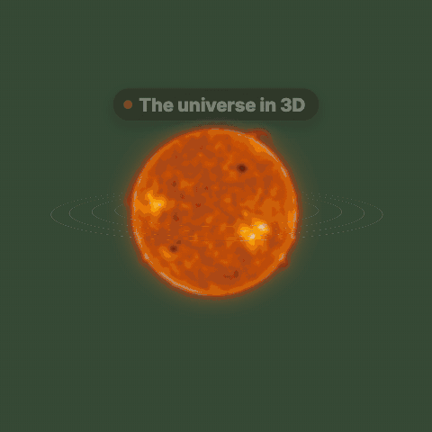

[English — documentação principal](README.md) · **Português** · [Español](README.es.md)

<a id="top"></a>

<p align="center">
  <picture>
    <source media="(max-width: 640px)" srcset="docs/assets/readme/hero-mobile.svg" />
    <source media="(prefers-reduced-motion: reduce)" srcset="docs/assets/readme/hero-still.svg" />
    
  </picture>
</p>

# editonny

**Sua história. Seu ritmo. Um fluxo completo de edição local.**

Edição local de vídeo por conversa. Uma skill reúne transcrição, cortes precisos, legendas, enquadramento, áudio e **145 cenas visuais** para **Codex** e **Claude Code**.

O código, os comandos, os arquivos e os contratos do projeto usam inglês; o guia e os pedidos que ele monta estão em português, inglês ou espanhol. Este README é uma tradução da apresentação principal. A fala dos seus vídeos pode continuar no idioma original.

[Começar a editar](#instalar) · [Ver as animações](#motion) · [Explorar o guia](#abrir-o-guia) · [Histórico de estrelas](#community)

<p align="center">
  <a href="https://github.com/soumatheusgomes/editonny/stargazers"></a>
  <a href="https://github.com/soumatheusgomes/editonny/actions/workflows/verify.yml"></a>
  <a href="LICENSE.md"></a>
</p>

| Cenas visuais | Exemplos de edição | Vídeos incluídos |
| :---: | :---: | :---: |
| **145** formas de explicar | **54** pontos de partida | **79** clipes originais |

## Comece com um pedido

Instale a skill, abra seu agente na pasta dos vídeos e descreva a edição. Você dirige o resultado; o editonny reúne ferramentas locais e biblioteca visual.

```text
$editonny
Edit a 45-second vertical video from /path/to/footage.
Keep complete takes, clean pauses, breaths, and mistakes, and add clear captions.
Use visual scenes only where they explain the story.
Verify an 8–15 second sample before finishing the export.
```

## Instalar

Prepare Python **3.9+** para o launcher, **uv**, **FFmpeg/ffprobe**, **Node.js 22.13+ ou 24+** e um agente configurado. O motor usa Python **>=3.10,<3.14**, selecionado pelo uv. As ferramentas precisam estar no `PATH`.

```sh
git clone https://github.com/soumatheusgomes/editonny.git
cd editonny
python3 install.py --target both
python3 ~/.local/share/editonny/scripts/editonny.py doctor
python3 ~/.local/share/editonny/scripts/editonny.py media status
```

Reinicie o agente. Use **`$editonny` no Codex** ou **`/editonny` no Claude Code**. Para somente um agente, use `--target codex` ou `--target claude`. A instalação compartilha uma cópia em `~/.local/share/editonny`, registrada por links.

Esses comandos registram a skill e preparam o ambiente Python. Para instalar tudo antes da primeira edição, peça ao agente para ler `skills/editonny/SKILL.md` e seguir o [procedimento de setup em inglês](skills/editonny/references/setup.md): preparar ferramentas locais compatíveis, renderizador e navegador nas versões fixadas, modelo padrão de transcrição, OCR local para conferir legendas, mídia incluída e testes sintéticos de prontidão. Downloads pendentes ou verificações que falharam devem ser informados antes de declarar a instalação completa. Cada uso confere o ambiente local e atualizações no GitHub; atualizar exige seu aceite.

Transcrição e render locais não exigem chave de API de LLM; a assinatura do seu agente é separada. Geradores externos são opcionais e exigem autorização antes de gastos ou envio de mídia.

Detalhes, instalação isolada, atualizações e recuperação: [guia de instalação em inglês](docs/installation.md).

## Abrir o guia

O guia é o site do editonny: monta pedidos de edição, mostra as 145 cenas de motion e os 54 pedidos de exemplo e explica a instalação em português, inglês ou espanhol (escolhido pelo idioma do navegador; sua escolha e seu briefing ficam salvos nesse navegador). Ele nunca recebe nem envia vídeos.

Para rodar localmente a partir deste repositório (Node.js 22.13+ ou 24+):

```sh
npm ci
python3 editonny.py guide
```

Inicia o servidor de desenvolvimento em `http://localhost:4173` e abre o navegador. Encerre com `Ctrl+C`; use `--port` para outra porta e `--no-open` para não abrir o navegador. `npm run dev` faz o mesmo na porta 3000.

<a id="motion"></a>

## Palavras, ideias e objetos em movimento

Três cenas reais da biblioteca incluída. Os trechos são silenciosos e recortados, com texto sintético e conteúdo ilustrativo. São exemplos, não vídeos de clientes.

<p align="center">
  <a href="docs/assets/readme/captions.gif">
  <picture>
    <source media="(prefers-reduced-motion: reduce)" srcset="docs/assets/readme/captions-still.png" />
    
  </picture>
  </a>
  <a href="docs/assets/readme/explain.gif">
  <picture>
    <source media="(prefers-reduced-motion: reduce)" srcset="docs/assets/readme/explain-still.png" />
    
  </picture>
  </a>
  <a href="docs/assets/readme/motion.gif">
  <picture>
    <source media="(prefers-reduced-motion: reduce)" srcset="docs/assets/readme/motion-still.png" />
    
  </picture>
  </a>
</p>

[Legendas sincronizadas](skills/editonny/visuals/scenes/text-chromatic.html) · [Explicações visuais](skills/editonny/visuals/scenes/building-panel.html) · [Movimento espacial](skills/editonny/visuals/scenes/solar-system.html)

As prévias reproduzem uma vez por 4,5 segundos. A preferência por movimento reduzido seleciona imagens estáticas. Abra uma prévia para reproduzi-la novamente.

## O que faz

Você descreve o resultado e informa a pasta dos vídeos. A skill orienta o agente a examinar as gravações, selecionar tomadas completas, medir cortes pela onda do áudio, montar um projeto, revisar uma amostra e exportar um MP4 conferido.

A limpeza padrão remove pausas desnecessárias, respirações audíveis, erros, falsos começos e repetições redundantes. Preserva palavras completas, ritmo natural, pausas intencionais e sentido. Ajustes pontuais respeitam o trecho solicitado. Os originais são preservados.

O guia inclui **54 exemplos de edição**, gerador de prompts e catálogo de cenas. Todos os prompts de edição incluem a política padrão de limpeza. O guia não recebe arquivos nem edita vídeos no navegador.

## Fluxo de edição

<p align="center">
  <picture>
    <source media="(max-width: 640px)" srcset="docs/assets/readme/workflow-mobile.svg" />
    <source media="(prefers-reduced-motion: reduce)" srcset="docs/assets/readme/workflow-still.svg" />
    
  </picture>
</p>

1. Escolha uma intenção no guia, informe a pasta e copie o pedido para o agente.
2. A skill inspeciona os arquivos selecionados, apresenta todas as predefinições e **aguarda sua confirmação**, mesmo com um prompt detalhado. O padrão preserva imagem, geometria e FPS; filtros e conversões de cor nunca são automáticos.
3. Após a aprovação, o trabalho fica em **Downloads/editonny/data-titulo/revisions/v001/**, com pastas separadas para edição, projeto e exportação. Revise uma amostra de **8–15 segundos**; escolha aprovação pelo usuário se quiser que o agente aguarde também nessa etapa.
4. Conclua por uma rota compatível e entregue MP4/legendas com nomes únicos e manifesto de verificação. Rotas de cor ou tempo incompatíveis são bloqueadas com uma explicação; execução remota precisa de um destino realmente acessível.

Mantenha vídeos, projetos e bibliotecas pessoais fora da skill. Números, ofertas, marcas e depoimentos de demonstração devem ser substituídos por fatos fornecidos. Imagens geradas não são provas.

## Estrutura

| Caminho | Função |
|---|---|
| `skills/editonny/` | Skill única e CLI |
| `skills/editonny/engine/` | Processamento local, preview e template de projeto |
| `skills/editonny/visuals/` | Cenas, catálogo, mídia incluída e receitas |
| `web/` | Guia público: app Next.js com montador de pedidos, catálogo, exemplos e instalação em três idiomas |
| `DESIGN.md` | Contrato visual e fonte da verdade dos tokens de design |
| `design-system/` | Biblioteca de componentes React, tokens, templates do preview, showcase e HTML de referência |
| `docs/` | Referências técnicas canônicas em inglês |
| `scripts/`, `tests/` | Pacotes, verificações de render e testes |

Projetos novos usam `project.json`, campos, comandos e IDs em inglês. Formatos experimentais anteriores não são suportados.

<details>
<summary><strong>Desenvolvimento, verificação e distribuição</strong></summary>

## Desenvolver e validar

```sh
npm ci --ignore-scripts
uv sync --locked --directory skills/editonny/engine
npm run build
npm run check
python3 editonny.py doctor
npm run test:engine
npm run test:browser
npm run test:preview
npm run test:scenes
python3 scripts/smoke_engine.py
```

`npm run test:browser` gera o guia e roda o Playwright (instale o Chromium dele uma vez com `npx playwright install chromium`). O teste de navegador do preview (`npm run test:preview`) exige `agent-browser`. O render exige FFmpeg e pode precisar de rede no primeiro uso. Confira as amostras antes de remover os temporários de `.work/`. [Resultados e limitações](docs/validation.md).

O repositório é um workspace npm: `web/` (`@editonny/web`) e `design-system/` (`@editonny/design-system`). `npm run build` gera o guia; `npm run check` roda lint, checagem de tipos, testes unitários e a verificação do registro de ícones (`npm run icons` o regenera a partir de `design-system/assets/icons/`). Abra `/design-system` no guia em execução para ver todos os componentes e estados nos dois temas; novas interfaces seguem o [DESIGN.md](DESIGN.md) e o [mapa da biblioteca](design-system/README.md).

### Publicar o guia

Importe o repositório na Vercel e defina **Root Directory** como `web`; a Vercel instala o workspace a partir da raiz e mantém o catálogo da skill disponível para o build. Defina `NEXT_PUBLIC_SITE_URL` com a origem pública (por exemplo, um domínio próprio) para links canônicos, `hreflang`, sitemap e imagens sociais; sem ela, usa o domínio de produção da Vercel.

## Empacotar

```sh
python3 scripts/package.py
```

Gera o ZIP do plugin, com SHA-256, em `dist/`. Ele contém a documentação técnica, a skill completa e **79 vídeos incluídos**. Cada edição recebe somente os clipes usados. O guia é publicado como site, fora do pacote. Gerar o pacote não publica nada nem altera sua instalação global.

</details>

<a id="community"></a>

## Acompanhe a história

Se o editonny ajudar no seu próximo vídeo, deixe uma estrela no projeto. Acompanhe a evolução, relate um problema ou sugira uma cena.

<a href="https://www.star-history.com/?repos=soumatheusgomes%2Feditonny&amp;type=date">
  <picture>
    <source media="(prefers-color-scheme: dark)" srcset="https://api.star-history.com/chart?repos=soumatheusgomes/editonny&amp;type=date&amp;theme=dark" />
    
  </picture>
</a>

[Dar uma estrela](https://github.com/soumatheusgomes/editonny/stargazers) · [Relatar um problema](https://github.com/soumatheusgomes/editonny/issues) · [Abrir histórico de estrelas](https://www.star-history.com/?repos=soumatheusgomes%2Feditonny&type=date)

O gráfico atualizado é fornecido pelo [Star History](https://www.star-history.com/blog/how-to-use-github-star-history/) e depende desse serviço. O selo no início mostra a contagem real de estrelas no GitHub.

## Autor e contato

Criado e mantido por **Matheus Gomes**.

- Instagram: [@matheusgomes](https://instagram.com/matheusgomes)
- Email: [eu@matheusgom.es](mailto:eu@matheusgom.es)
- GitHub: [soumatheusgomes/editonny](https://github.com/soumatheusgomes/editonny)

## Licença

Código e documentação próprios usam a [licença MIT](LICENSE.md). Bibliotecas, modelos, fontes, áudio e mídia de terceiros mantêm suas licenças e atribuições; a MIT não substitui esses termos. Consulte os [avisos de terceiros](skills/editonny/engine/THIRD_PARTY_NOTICES.md) e os avisos junto aos recursos antes de redistribuir.

[Produto](PRODUCT.md) · [Arquitetura](docs/architecture.md) · [Interface](docs/design.md) · [Integrações](docs/integrations.md) · [Setup de desenvolvimento](docs/setup.md)

<p align="center"><strong>YOUR STORY. ITS OWN RHYTHM.</strong><br /><a href="#top">Voltar ao início ↑</a></p>
